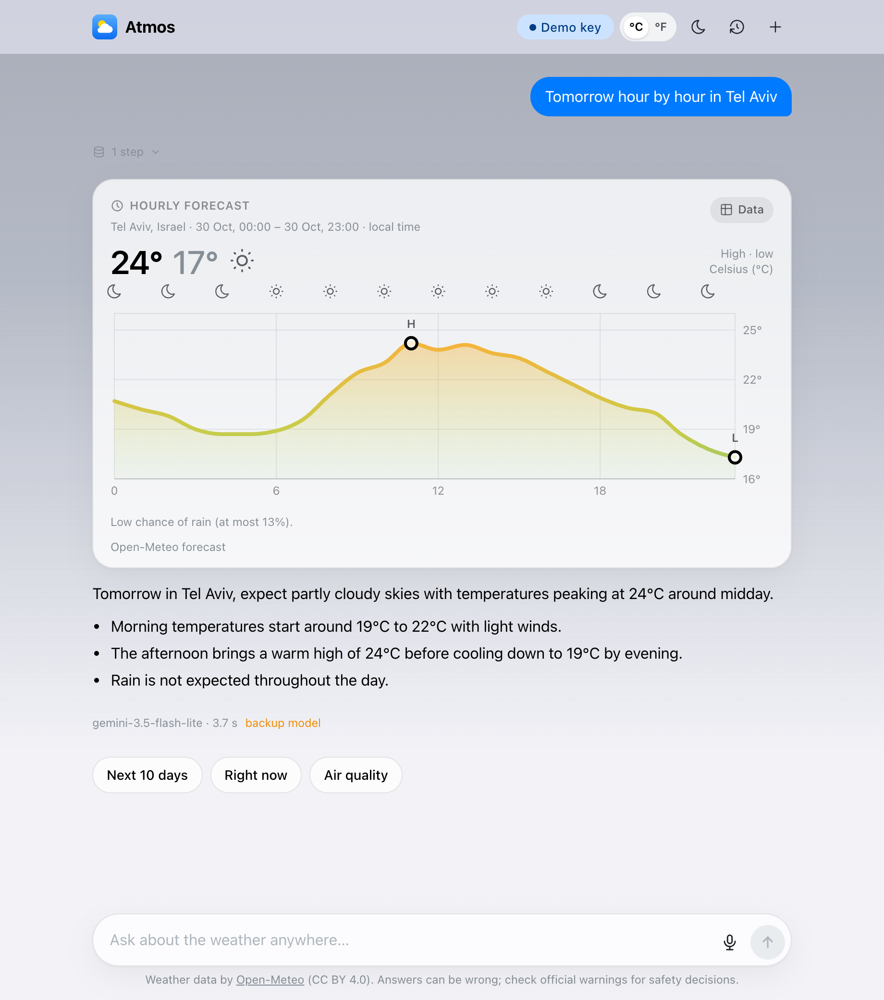
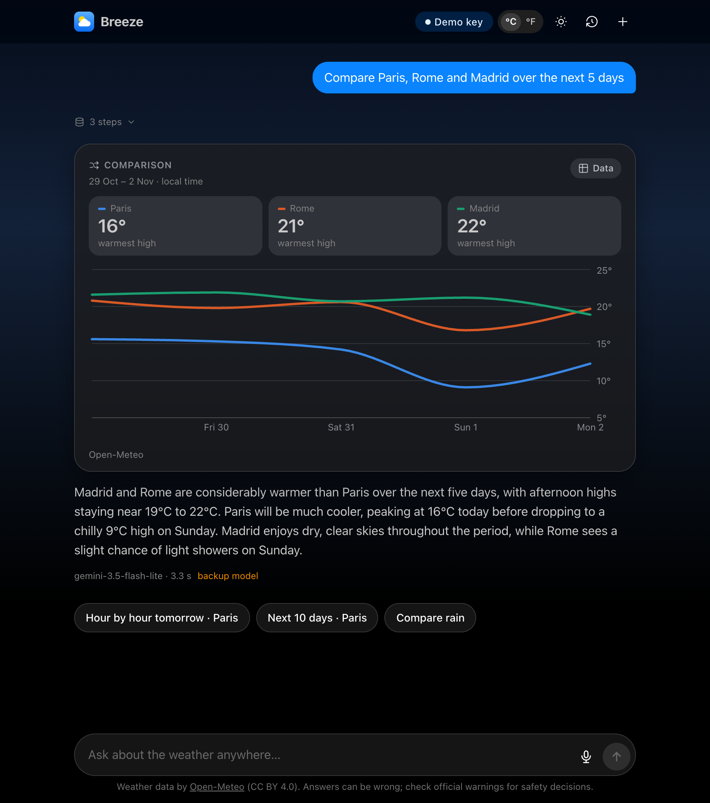

# Breeze

A chat about the weather anywhere in the world. Ask about forecasts, past weather or air quality: an AI agent fetches
real data from [Open-Meteo](https://open-meteo.com/), streams its answer, and adds a chart when the answer is a trend
or a comparison.

| | |
|---|---|
|  |  |

## Run it

Requires Node 22.12+ (or Docker, below) and an LLM key. A free [Gemini key](https://aistudio.google.com/apikey) works; Groq, Anthropic
and OpenAI keys do too.

```bash
npm install
cp server/.env.example server/.env    # add GOOGLE_GENERATIVE_AI_API_KEY
npm run dev                           # → http://localhost:5180
```

No key in `server/.env`? Paste one in the app under **Model & key**; it is checked on the spot and stays in your browser.

| | Command | URL |
|---|---|---|
| Server only | `npm run dev -w server` | http://localhost:8787 (API) |
| Client only | `npm run dev -w client` | http://localhost:5180 (forwards `/api` to the server) |
| Production build | `npm run build && npm start` | http://localhost:8787 |

### With Docker

No Node needed, only Docker. The key is optional here too: put it in `server/.env` as above, or paste it in the app.

```bash
docker compose up --build             # → http://localhost:8787
```

Chats are kept in a Docker volume between runs. Without Compose:

```bash
docker build -t breeze .
docker run -p 8787:8787 -v breeze-data:/data breeze    # add --env-file server/.env to use your key from the file
```

## When does a chart appear?

When the answer is a pattern over time or a comparison. The agent decides by calling `show_chart`; the server checks
the request against the rules and builds the chart from the fetched data, so the numbers on a chart never come from
the model.

| Ask about… | Example | Chart |
|---|---|---|
| 3 or more days | *What will the weather be like in Tokyo this week?* | daily forecast |
| the next hours or one day | *Will it rain in London in the next 24 hours?* | hour by hour |
| rain or snow amounts | *How much rain fell in Mumbai in the last two weeks?* | precipitation |
| 2–4 places | *Compare Paris, Rome and Madrid over the next 5 days* | comparison |
| whether it was unusual | *Was last month warmer than normal in New York?* | difference from normal |
| air quality | *How's the air quality in Delhi over the next few days?* | air quality index |

**No chart** for a single value or "right now" (a current-conditions card instead), for three or fewer data points,
or for follow-ups that bring no new data. Every chart has a **Data** toggle with the same values as a table.

The rule is enforced, not just suggested: when an answer fetched data like this and no chart was drawn, the agent's
next step must call `show_chart`. Add *"text only"* to a question to skip the chart; the answer then offers
**Show as a chart**.

## How it works

- **Agent:** an [AI SDK](https://ai-sdk.dev) tool loop with six tools (find a place, current conditions, forecast,
  history, air quality, chart). Tools return compact summaries; full data stays on the server.
- **Streaming:** answers keep running on the server, so a refresh or a dropped connection resumes the same answer.
- **Models:** Gemini by default, or any supported provider with your own key; a backup model answers when one is
  rate-limited.
- **Storage:** SQLite for chats and a weather API cache. Each browser sees only its own chats.

TypeScript throughout: Hono and Node on the server, React, Mantine and Recharts on the client.

## Tests

```bash
npm test          # unit tests
npm run e2e       # browser tests (Playwright, installed Chrome), no key needed
npm run evals     # chart and grounding checks against the real model, needs a key
```

---

Weather data by [Open-Meteo](https://open-meteo.com/) (CC BY 4.0). Design decisions are in [PLAN.md](PLAN.md).
